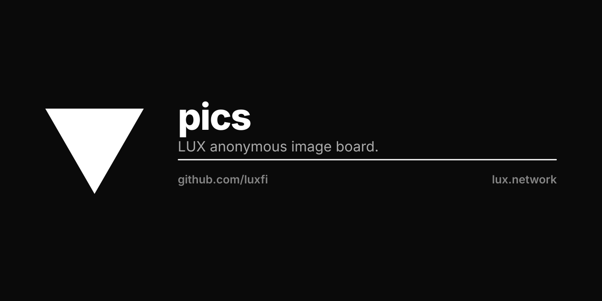
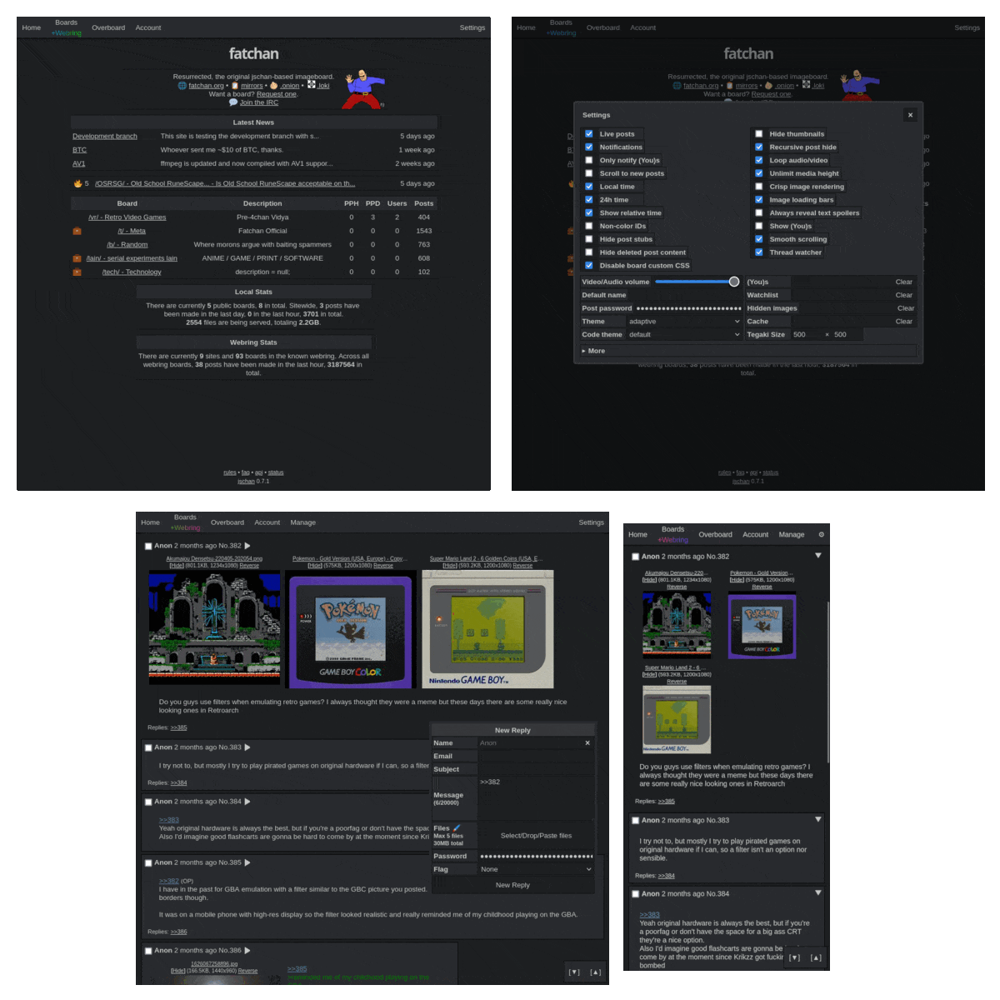

# pics

Lux anonymous imageboard software that doesn't suck.

## Live instances (Unofficial)
 - 🇺🇸 [94chan](https://94chan.org)
 - 🇵🇹/🇧🇷 [ptchan](https://ptchan.org)
 - 🇺🇸/🇰🇷 [heolkek](https://heolkek.cafe)
 - 🇺🇸 [zzzchan](https://zzzchan.xyz)
 - 🇧🇷 [27chan](https://27chan.org)
 - 🇺🇸 [jakparty](https://jakparty.soy)
 - 🇮🇹 [nuichan](https://niuchan.org)
 - And many more...

## Features
 - [x] Multiple language support (🇬🇧 🇵🇹 🇧🇷 🇷🇺 🇮🇹 🇪🇸)
 - [x] Optional user created boards
 - [x] Multiple files per post
 - [x] Antispam/Anti-flood & DNSBL
 - [x] 3 customisable inbuilt captchas + 3 third party captchas (hcaptcha, recaptcha, yandex smartcaptcha)
 - [x] Two factor authentication (TOTP) for accounts
 - [x] Manage everything from the web panel
 - [x] Granular account permissions
 - [x] Works properly with anonymizer networks (Tor, Lokinet, etc)
 - [x] Web3 integration - register, login, and sign posts with [MetaMask](https://metamask.io)
 - [x] [Tegaki](https://github.com/desuwa/tegaki) applet with drawing and replays
 - [x] [API documentation](https://fatchan.gitgud.site/jschan-docs/)
 - [x] Built-in webring (compatible w/ [lynxchan](https://gitlab.com/alogware/LynxChanAddon-Webring) & [infinity](https://gitlab.com/Tenicu/infinityaddon-webring))
 - [x] Beautiful bundled frontend with lots of themes and options, see below:

## License
GNU AGPLv3, see [LICENSE](LICENSE).

## Installation & Upgrading
See [INSTALLATION.md](INSTALLATION.md) for instructions on setting up a jschan instance or upgrading to a newer version.

## Changelog
See [CHANGELOG.md](CHANGELOG.md) for changes between versions.

## Contributing
See [CONTRIBUTING.md](CONTRIBUTING.md) for contribution guidelines.
